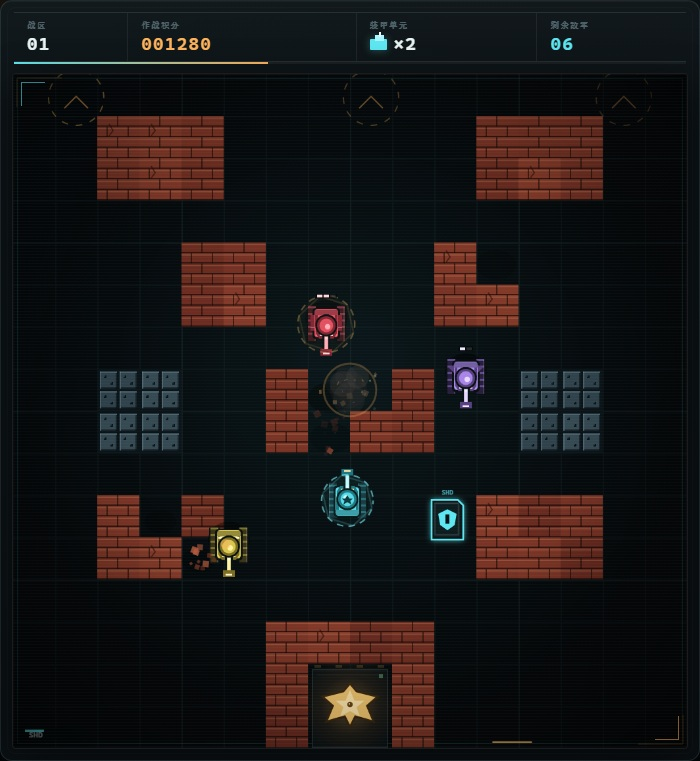

# 坦克大战 · STEEL VANGUARD

一款致敬经典《Battle City》的复古街机风坦克大战，使用原生 **HTML5 Canvas + CSS + JavaScript** 制作。无框架、无外部素材、无需构建，打开浏览器即可游玩。

**[▶ 在线试玩](https://gbj18479830620.github.io/tank-battle/)** · **[查看仓库](https://github.com/gbj18479830620/tank-battle)**



## 游戏内容

- **三个战区**：前哨站 → 熔炉 → 核心，每关地图与敌军配置不同。
- **四种敌军**：侦察兵、突击者、重装者、猎杀者，拥有不同速度、血量和火力。
- **基地防守**：砖墙可被炮弹击毁，钢墙不可破坏；基地一旦失守立即失败。
- **战场补给**：能量护盾、速射模块、备用装甲、低温脉冲四种随机掉落。
- **完整街机流程**：倒计时、暂停、关卡结算、最终胜利、本地最高分。
- **沉浸表现**：程序化像素画面、粒子爆炸、屏幕震动、Web Audio 合成音效。
- **多端操作**：桌面端键盘操作，移动端提供触屏方向键与开火按钮。

## 操作方式

| 操作 | 按键 |
| --- | --- |
| 移动 | `W` `A` `S` `D` 或方向键 |
| 开火 | `空格` / `J` / `K` |
| 暂停 / 继续 | `P` / `Esc` |
| 开始 / 确认 | `Enter`（或在界面上点击） |

手机上直接使用画面下方的方向键和 **FIRE** 按钮。

## 玩法提示

1. 基地南侧的砖墙是最后的掩护，必要时可以主动打穿砖墙开辟射击路线。
2. 重装者需要三发炮弹才能击毁，猎杀者拥有更高的射速。
3. 护盾可以扛住一轮火力；速射模块和低温脉冲适合用来解围。
4. 击毁敌军有概率掉落补给，靠近即可拾取。
5. 在每一关清空全部敌军即可进入下一战区。

## 本地运行

项目没有依赖与构建步骤，直接双击 `index.html` 也可以运行。推荐通过本地 HTTP 服务打开：

```bash
# 任选一种
python -m http.server 8000
npx serve .
```

然后访问 <http://localhost:8000>。

## 部署到 GitHub Pages

1. 将仓库默认分支设为 `main`。
2. 在 GitHub 仓库中打开 **Settings → Pages**。
3. Source 选择 **Deploy from a branch**，分支选择 `main`，目录选择 `/ (root)`。
4. 保存后等待 Pages 构建完成即可通过 `https://<用户名>.github.io/tank-battle/` 访问。

## 项目结构

```
.
├── index.html      # 页面结构与 HUD
├── style.css       # 响应式界面、CRT 视觉与触屏控制
├── game.js         # 游戏循环、AI、碰撞、渲染与音效
├── favicon.svg     # 站点图标
└── docs/
    └── preview.jpg # README 游戏截图
```

## 技术说明

- 固定时间步长的游戏循环，速度表现不受帧率波动影响。
- 16 × 16 网格地图，坦克、砖墙、钢墙、水面、树丛与基地独立碰撞处理。
- 敌军 AI 会朝玩家或基地推进、对齐射击，并在受阻时重新选择路线。
- 音效由 Web Audio API 实时合成，无任何音频文件。
- 最高分保存于 `localStorage`。
- 适配桌面与移动端，支持触屏多指操作。

## 说明

本项目为独立制作的致敬作品，未使用原版《Battle City》的任何素材或代码。
